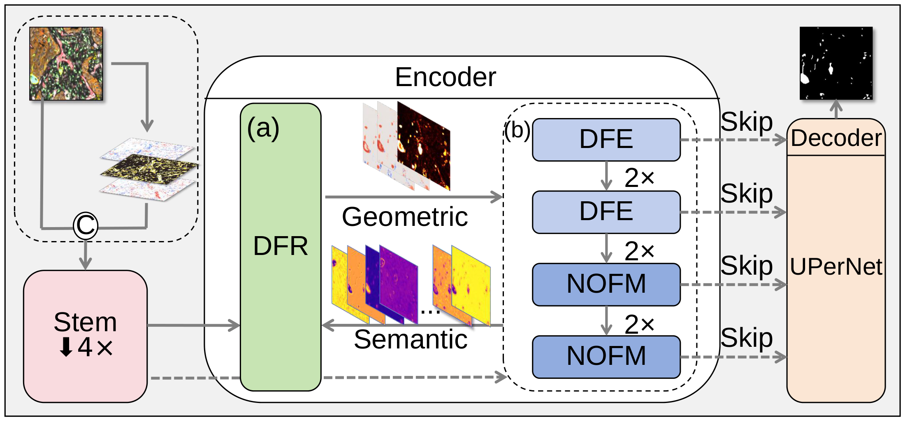
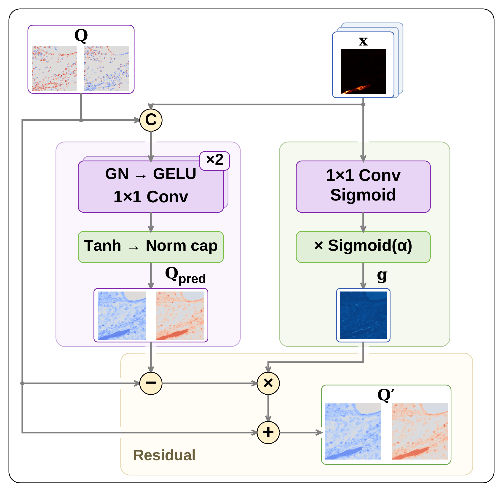
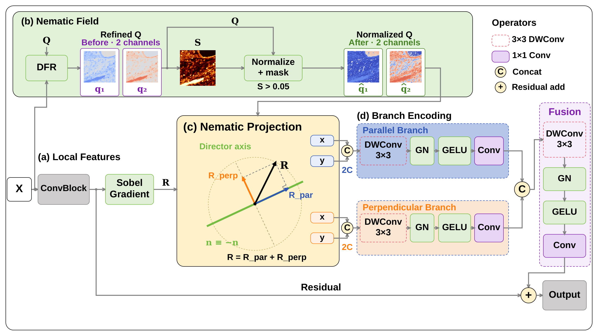
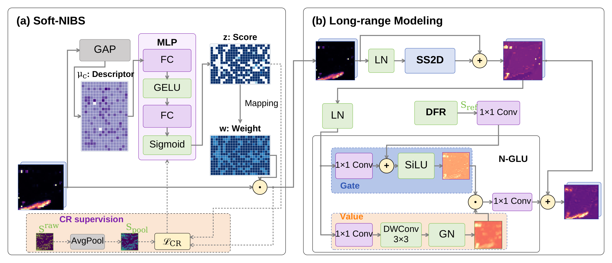

# NFAM-Net

[English](README.md) | **简体中文**

NFAM-Net 在分割监督下联合学习显式向列相场与语义特征，用于细长结构分割。表征将同一轴线的相反切向视为等价状态；语义特征逐层精化图像导出的场，精化后的 director 与 nematic order 分别指导不同尺度的特征学习。本说明介绍 NeuriteOutgrowth、NeuroQuantify 和 ARCADE 三个公开数据集。

## 方法概述

图像导出的向列相场用于解析初始化，**DFR 随后利用语义特征学习精化该场**。初始化与可学习更新承担不同作用。

| 组件 | 作用 |
| --- | --- |
| **DFR — Director Field Refinement** | 在编码器块前，通过门控残差更新场的两个分量。 |
| **DFE — Director Field Enhancement** | 将浅层特征梯度投影到平行和垂直于 director 的方向，分别编码并融合。 |
| **NOFM — Nematic Order-aware Feature Modulation** | 结合 Soft-NIBS 通道重加权、SS2D 上下文建模，以及由精化序图调控的 N-GLU。 |
| **解码器** | 通过 UPerNet 风格的解码头融合多尺度特征，输出分割掩码。 |

[](docs/figures/framework.pdf)

*NFAM-Net 总体框架，点击图片可打开 PDF 原图。*

向列相场由两个分量表示：

$$
q_1=S\cos(2\theta),\qquad q_2=S\sin(2\theta),\qquad S=\sqrt{q_1^2+q_2^2}.
$$

双角编码保持头尾对称。网络精化 `q1`、`q2`，`S` 由二者计算，而非第三个独立预测分量。原始 nematic order 描述局部轴向取向一致程度；精化序图作为学习得到的几何提示。原始序图提供 CR 训练监督，精化序图进入 N-GLU 前向门控，二者的路径不同。整个过程无需额外取向标注。

### 模块图

以下使用当前绘制的模块图，PNG 用于网页预览，并提供 PDF 原图便于查看细节。

<details>
<summary><strong>DFR — Director Field Refinement</strong></summary>

语义特征预测双分量候选场，共享空间门控控制其残差更新。

[](docs/figures/dfr.pdf)

[查看 DFR 的 PDF 原图](docs/figures/dfr.pdf)

</details>

<details>
<summary><strong>DFE — Director Field Enhancement</strong></summary>

向列相投影将特征梯度分解为平行和垂直于 director 的响应，两路独立编码、融合后通过残差连接输出。

[](docs/figures/dfe.pdf)

[查看 DFE 的 PDF 原图](docs/figures/dfe.pdf)

</details>

<details>
<summary><strong>NOFM — Nematic Order-aware Feature Modulation</strong></summary>

Soft-NIBS 调整通道权重，SS2D 建模长程上下文，精化序图调控 N-GLU。图中虚线路径表示 CR 的训练依赖。

[](docs/figures/nofm.pdf)

[查看 NOFM 的 PDF 原图](docs/figures/nofm.pdf)

</details>

## 环境安装

使用 Linux、NVIDIA GPU 及支持 CUDA 的 PyTorch。SS2D 使用 [networks/VMamba](networks/VMamba) 中随仓库提供的 Mamba-3 **Triton SISO** 实现；当前训练和测试入口直接调用 CUDA。

```bash
git clone https://github.com/SenpeWang/NFAM-Net.git
cd NFAM-Net
conda create -n nfam-net python=3.10 -y
conda activate nfam-net
python -m pip install -r requirements.txt
```

按 [PyTorch 官方安装说明](https://pytorch.org/get-started/locally/)选择与 GPU、CUDA 环境匹配的版本，再检查环境：

```bash
python -c "import torch, triton; print('PyTorch:', torch.__version__, 'CUDA:', torch.version.cuda, 'Triton:', triton.__version__); assert torch.cuda.is_available()"
python train.py --help
python test.py --help
```

本次核对的开发环境为 Python **3.10.20**、PyTorch **2.12.0+cu130**、Triton **3.7.0**、NumPy **2.2.6**。[requirements.txt](requirements.txt) 中的版本下限是依赖声明，不代表所有版本组合均已验证。当前默认后端不使用单独安装的 `mamba-ssm` 或 `selective_scan` 扩展。

## 数据准备

在 [datasets/dataset_config.py](datasets/dataset_config.py) 中，将各数据集的 `root` 改为本机路径。文件目前保留的是开发环境中的本地路径。

| 数据集参数 | 输入通道数 | 数组排列 | 掩码目录 |
| --- | ---: | --- | --- |
| `NeuriteOutgrowth` | 1 | `HW` | `labels/` |
| `NeuroQuantify` | 1 | `HW` | `labels/` |
| `ARCADE` | 1 | `HW` | `masks/` |

NeuriteOutgrowth 和 NeuroQuantify 使用以下目录结构：

```text
DATASET_ROOT/
├── train/
│   ├── images/
│   └── labels/
├── val/
│   ├── images/
│   └── labels/
└── test/
    ├── images/
    └── labels/
```

ARCADE 使用 **1,000 张训练图像、200 张测试图像**：

```text
ARCADE_ROOT/
├── train/
│   ├── images/
│   └── masks/
└── test/
    ├── images/
    └── masks/
```

ARCADE 注册项将逻辑上的 `val` 映射到 `train`，因此模型选择时读取训练集；`test.py` 读取独立的测试集。该配置无需另建 `val/` 目录。

图像支持 `.tif`、`.tiff` 和 `.png`。每张图像必须有同名主文件名的 `.png` 掩码，例如 `images/case001.tif` 对应 `labels/case001.png`，ARCADE 则对应 `masks/case001.png`。掩码中非零像素视为前景。加载器默认将图像与掩码缩放至 **512 × 512**；单通道公共数据集的归一化和增强由注册表配置。

### 公共数据获取

- **NeuriteOutgrowth：**[作者仓库及数据入口](https://github.com/YoavLotem/NeuriteOutgrowth)。
- **NeuroQuantify：**[Edmond 数据集，DOI：10.17617/3.UIBMJX](https://doi.org/10.17617/3.UIBMJX)。
- **ARCADE：**[数据集仓库](https://github.com/cmctec/ARCADE)。

先下载并按上述结构整理数据，再运行程序。仓库不附带数据文件和模型权重。

## 训练

配置好数据路径后，可运行 ARCADE 训练：

```bash
python train.py --dataset ARCADE --batch_size 2 --lr 3e-4 --seed 1234 --gpu 0
```

同一入口也支持另外两个公开数据集：

```bash
python train.py --dataset NeuriteOutgrowth --gpu 0
python train.py --dataset NeuroQuantify --gpu 0
```

`--gpu` 指定可见 GPU 编号。程序自动在 `Outputs/Train/` 下创建运行目录；可用 `--tag` 标记实验，或用 `--output_root` 指定其他输出位置。

### 默认参数与配置

以下为当前**训练入口的默认值**，不代表同一配置对所有数据集都最优。

| 配置项 | 默认值 | 修改方式 |
| --- | --- | --- |
| 批大小 | 2 | `--batch_size` |
| 学习率 | `3e-4` | `--lr` |
| 随机种子 | 1234 | `--seed` |
| EMA | 启用 | `--ema` / `--no-ema` |
| Soft-NIBS 通道权重下限 | 0.70 | `--nibs_floor` |
| 向列相场损失权重 | 0.30 | `--lambda_nematic` |
| CR 信息项／瓶颈项权重 | 0.03 / 0.05 | `--lambda_cr_info` / `--lambda_cr_b` |
| 序监督／Frank–Oseen 权重 | 1.0 / 1.0 | `--s_weight` / `--fo_weight` |
| BCE／Dice 权重 | 0.3 / 0.7 | `--bce_weight` / `--dice_weight` |

其他设置见 [configs/config.py](configs/config.py)。`train.py` 会覆盖 `Config` 中的部分损失权重，实际使用的参数以各次运行保存的 `config.yaml` 为准。

## 测试与可视化

将 `RUN_DIR` 改为实际生成且包含 `checkpoints/` 的训练目录：

```bash
RUN_DIR="Outputs/Train/your_run"
python test.py --dataset ARCADE --train_dir "$RUN_DIR" --ckpt_type best_dice --gpu 0
```

默认保存二值预测掩码及指标报告。添加 `--vis` 后，还会保存原图／标注／预测对比，以及各阶段向列相场可视化：

```bash
python test.py --dataset ARCADE --train_dir "$RUN_DIR" --ckpt_type best_dice --vis --gpu 0
```

仅计算指标、不保存图像：

```bash
python test.py --dataset ARCADE --train_dir "$RUN_DIR" --ckpt_type best_dice --no_save_images --gpu 0
```

也可以直接指定权重文件：

```bash
python test.py --dataset ARCADE --ckpt "$RUN_DIR/checkpoints/best_dice_model.pth" --gpu 0
```

权重类型支持 `best_dice`、`best_loss`、`best_ema`、`last`，默认 `best_dice`。只有启用 EMA 且保存过性能改进时，才会产生对应的 EMA 权重。测试时应使用与权重匹配的数据集、网络结构和预处理设置。消融模式会从运行目录中的 `summary.json` 或目录名推断，也可用 `--ablation` 显式指定。

评估将前景 softmax 概率以 **0.5** 阈值二值化，输出 **Dice、IoU、Precision、Recall、clDice**，数值范围为 0–1。均值和标准差按有效图像汇总；标注与预测同时为空的图像不计入均值，其 `valid` 标记仍保存在 `test_report.json` 中。

## 组件消融

```bash
python train.py --dataset ARCADE --ablation baseline --gpu 0
python train.py --dataset ARCADE --ablation wo_dfr --gpu 0
```

| `--ablation` | 相对完整模型的变化 |
| --- | --- |
| `full` | 启用全部向列相组件。 |
| `baseline` | 移除向列相先验、场更新、定向投影、Soft-NIBS 和序条件门控，保留卷积／状态空间骨干。 |
| `wo_dfe` | 浅层模块绕过向列相投影。 |
| `wo_dfr` | 仅移除可学习场更新，保留特征学习及图像导出的场。 |
| `wo_nibs` | 绕过 Soft-NIBS 通道重加权，并关闭对应 CR 损失。 |
| `wo_sgate` | 深层门控不再接收精化序图的条件输入。 |

损失和通道下限实验使用默认参数表中的相应权重参数。Soft-NIBS 是**通道重加权机制**，不是拓扑边界约束。

## 表征实验

附加脚本在 ARCADE 上比较有符号极性场 `P` 与符号增强极性场 `P_AUG`：

```bash
python scripts/train_arcade_polar.py --group P --dataset ARCADE --gpu 0
python scripts/train_arcade_polar.py --group P_AUG --dataset ARCADE --gpu 0
```

将 `POLAR_RUN_DIR` 改为对应运行目录，并选择训练时使用的组别：

```bash
POLAR_RUN_DIR="Outputs/Polar/Train/your_run"
python scripts/eval_arcade_polar.py --group P_AUG --dataset ARCADE --train_dir "$POLAR_RUN_DIR" --ckpt_type best_dice --gpu 0
```

该脚本固定权重，评估 `normal`、`global_flip`、`alternate_halfplane`、`quadrants` 四种方向赋值，结果保存在运行目录的 `eval_best_dice_reversal_results.json`。符号增强属于实验对比，不会使极性表征本身获得结构性的头尾对称。

[scripts/eval_arcade_axis_prior_study.py](scripts/eval_arcade_axis_prior_study.py) 独立分析 ARCADE 测试集上的**几何表征方法**。运行前需修改其 `main()` 中的 `img_dir`、`mask_dir`、`out_dir`；Markdown 报告导出还需安装 `tabulate`（`python -m pip install tabulate`）。该工具的测试集分析与四个数据集的全量分析范围不同。

## 输出文件

```text
Outputs/
├── Train/<run>/
│   ├── config.yaml
│   ├── summary.json
│   ├── metrics.txt
│   ├── loss_details.txt
│   ├── tensorboard/
│   └── checkpoints/
│       ├── best_dice_model.pth
│       ├── best_loss_model.pth
│       ├── best_ema_model.pth
│       ├── last_model.pth
│       └── last_training_state.pt
└── Test/<run>/
    ├── test_report.json
    ├── test_report.txt
    ├── pred/
    ├── comparison/             # 使用 --vis 时
    └── nematic/stage0...stage3/ # 使用 --vis 时
```

`--no_save_images` 模式不生成 `pred/`。训练日志可通过 `tensorboard --logdir Outputs/Train` 查看。

## 项目结构

```text
configs/     训练与网络配置
datasets/    数据集注册、加载与增强
networks/    NFAM-Net、DFR、DFE、NOFM、Q-tensor 运算与解码器
  VMamba/    SS2D 及随仓库提供的 Mamba-3 后端
utils/       损失、指标、可视化与日志
experiment/  极性场表征及其损失变体
scripts/     ARCADE 表征对比与几何分析实验
train.py     训练入口
test.py      评估入口
```

## 应用于新数据集

1. 按上述目录结构整理图像和掩码。
2. 在 `DATASET_REGISTRY` 中增加根目录、通道数、数组排列和掩码目录。可选字段包括 `label_suffix`、`normalize`、`intensity_aug`、`oversample`、`split_map`。
3. 同时将数据集名称加入 `train.py`、`test.py` 的 `--dataset` 参数可选项。
4. 使用匹配的数据配置，通过相同入口训练和测试。

## 致谢

状态空间路径基于 VMamba 和随仓库提供的 Mamba-3 Triton 实现。Mamba-3 内核文件保留 Dao AI Lab／Goombalab 的版权声明，具体归属见相应源文件。
